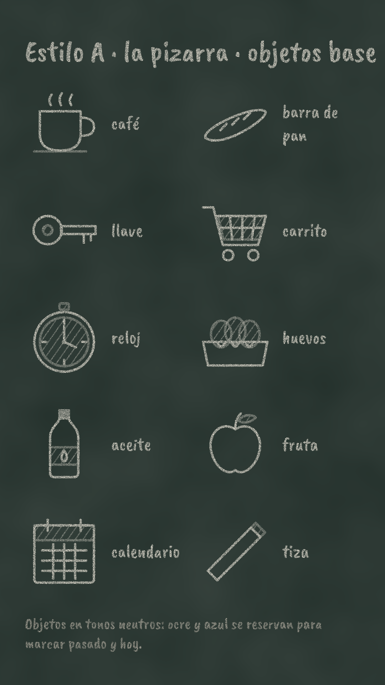
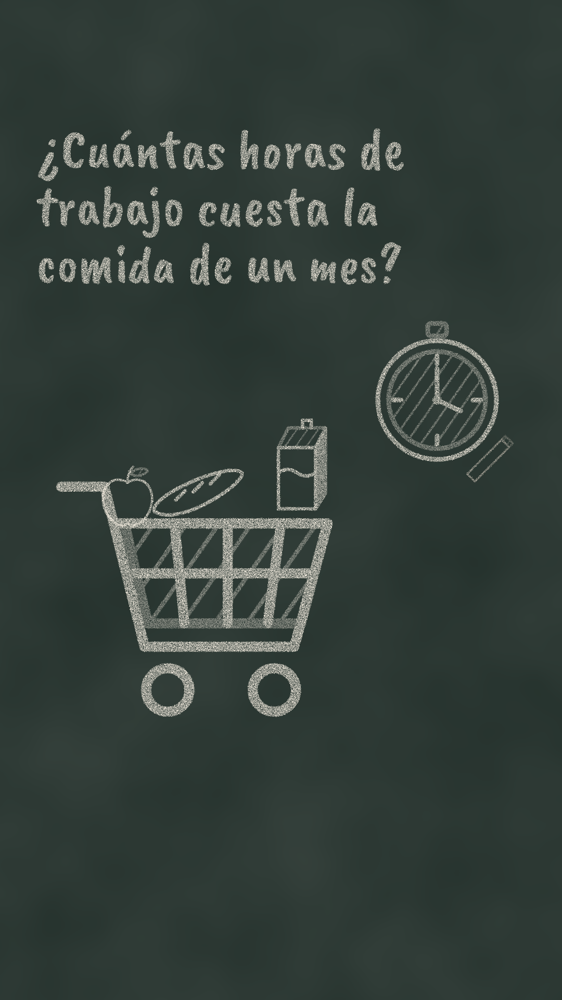
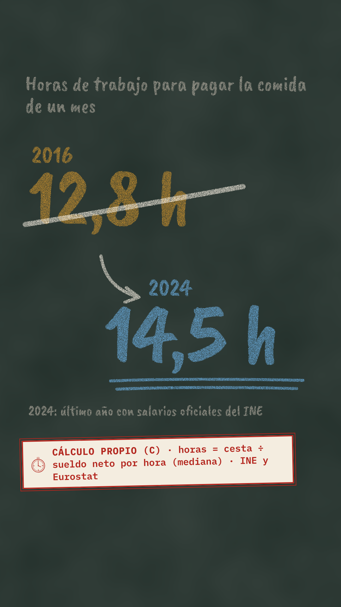
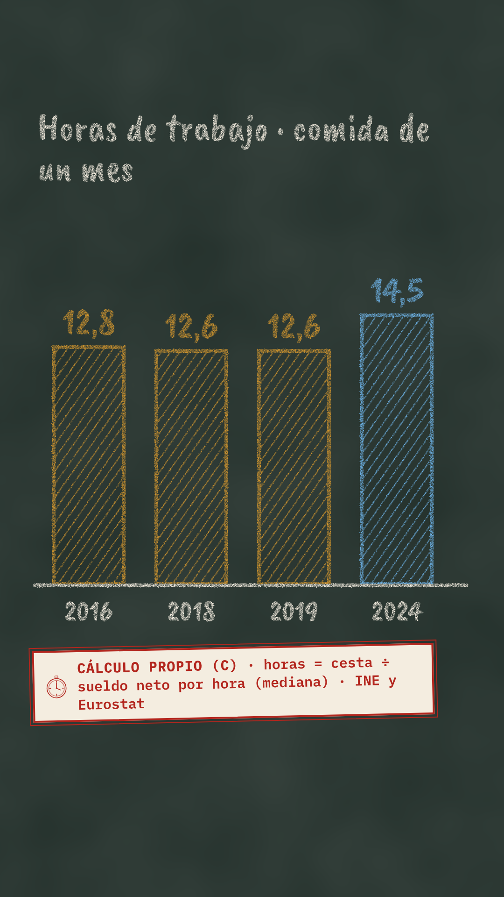
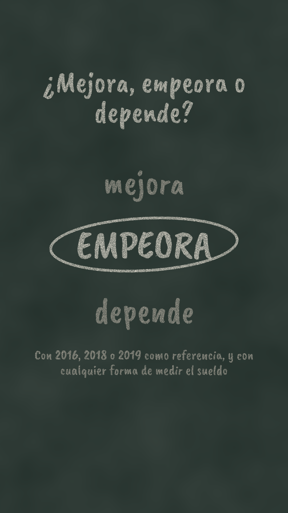

# Biblia del estilo A · La pizarra

Una pizarra verde de bar donde los números se escriben a mano con tiza: lo del pasado se **tacha** y lo de hoy se escribe al lado. Cercano, de pizarra de menú del día, sin personajes.

Sistema común (sello, colores del tiempo, cierre, zona segura): `diseno/README.md`.

## Paleta
| Papel | Color | Contraste sobre pizarra |
|---|---|---|
| Fondo | pizarra `#23302B` con borrones de tiza (ruido, opacidad 9 %) | — |
| Tiza blanca (texto y dibujo) | `#F4EDE0` | 11,8:1 |
| Pasado | ocre `#C8902E` | 4,89:1 |
| Hoy | azul de tiza `#6AADDF` | 5,66:1 |
| Notas | gris de tiza `#B1AB9F` | 6,01:1 |
| Sello | etiqueta de papel con rojo `#B3261E` | 5,61:1 sobre papel |

## Trazo y textura
- Trazo de 6 px en objetos, 8-16 px en tachados y subrayados, con puntas redondas.
- Filtro «tiza» (`#tiza` en `diseno/escenas.mjs`): grano que deja huecos y bordes temblorosos de 3 px. Se aplica a texto, objetos y gráficos.
- Rellenos: solo rayado diagonal de tiza (35°), nunca macizo.
- Letra: Caveat Brush para todo lo escrito a mano (títulos y cifras). El sello sigue en IBM Plex Mono: es lo único «impreso» de la pizarra.

## 10 objetos base
Café, barra de pan, llave, carrito, reloj, huevos, aceite, fruta, calendario y tiza (`diseno/objetos.mjs`). Siempre en tiza blanca; el ocre y el azul se reservan para marcar pasado y hoy.

## Composiciones tipo

| 1 · Pregunta y objeto | 2 · El tachado | 3 · Barras de tiza | Cierre |
|---|---|---|---|
|  |  |  |  |

1. **Pregunta y objeto:** la pregunta escrita a mano arriba; abajo, el carrito con la compra y el reloj, dibujándose.
2. **El tachado** (firma del estilo): la cifra del pasado en ocre, tachada con una raya de tiza; flecha; la de hoy en azul, más grande y subrayada dos veces.
3. **Barras de tiza:** barras desde cero con rayado, la cifra escrita encima y el año debajo. Pasado en ocre, hoy en azul.
4. **Cierre:** «mejora · EMPEORA · depende», con la palabra elegida rodeada por un círculo de tiza blanca.

## Movimiento (para el Paso 4)
- Todo se dibuja: trazos con `stroke-dashoffset` (0,6-1,2 s por objeto) y texto revelado de izquierda a derecha con máscara, como si se escribiera.
- El tachado cruza la cifra en 0,4 s y después aparece la nueva.
- Un trozo de tiza (objeto «tiza») sigue la punta del trazo; **sin mano humana**.
- Cambio de plano: borrado con trapo (barrido de 0,3 s que deja polvo).

## Prohibido en este estilo
- Mano humana realista o generada por IA (rara y cara de mantener coherente).
- Rotulado generado por IA: el texto siempre sale de Caveat Brush.
- Tiza de colores fuera de la paleta. Rellenos macizos.
- Pizarra escolar con aula, pupitres o profesor: es una pizarra de bar sin escena.
- Lo prohibido del sistema común (`diseno/README.md`).

## Riesgos y mitigación
| Riesgo | Mitigación |
|---|---|
| Que la letra a mano cueste leerla en el móvil | Caveat Brush ≥ 46 px; cifras ≥ 80 px; contraste ≥ 4,89:1 |
| Que se parezca a otros canales tipo *Draw My Life* | Sin mano ni personaje; la firma es el tachado ocre → azul y el sello impreso |
| Que el fondo oscuro choque con la miniatura | Miniatura con la cifra de hoy en azul de tiza y la del pasado tachada |

## Tests de calidad (autoevaluación)
| Test | Resultado |
|---|---|
| Fotograma | Pizarra, letra de tiza, tachado y sello rojo: se reconoce sin logo |
| Móvil | Cifras de 80-270 px; texto mínimo de 46 px (30 px en el sello) |
| Neutralidad | Sin partidos ni personas; veredicto marcado con círculo blanco, no con color |
| Dato | Sello con fuente o fórmula en cada plano con cifras |
| Copia | Diseño propio; sin personajes ni manos |
