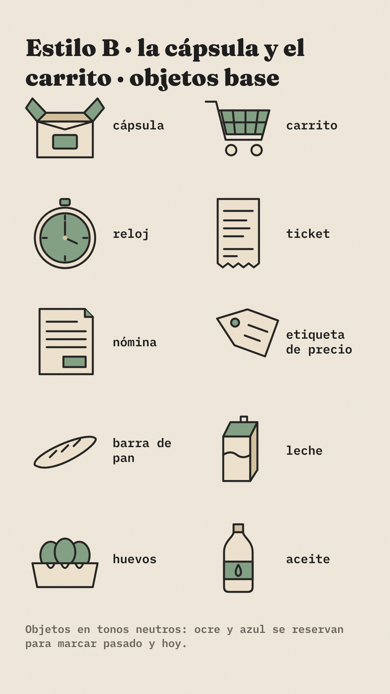
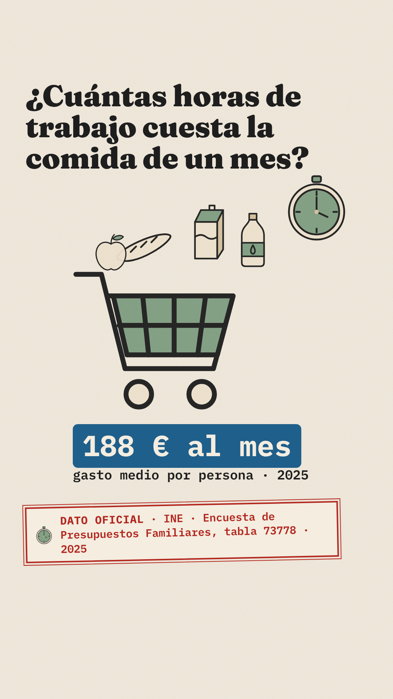
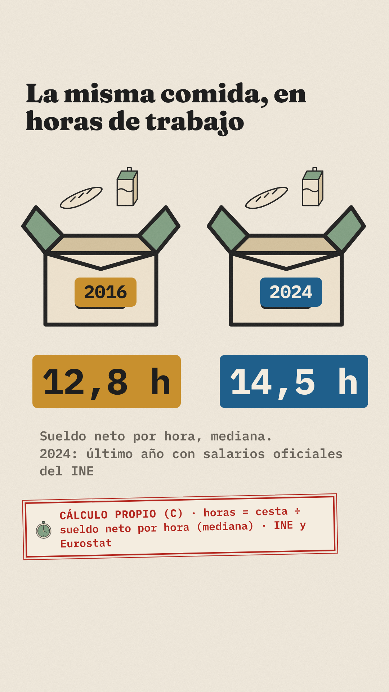
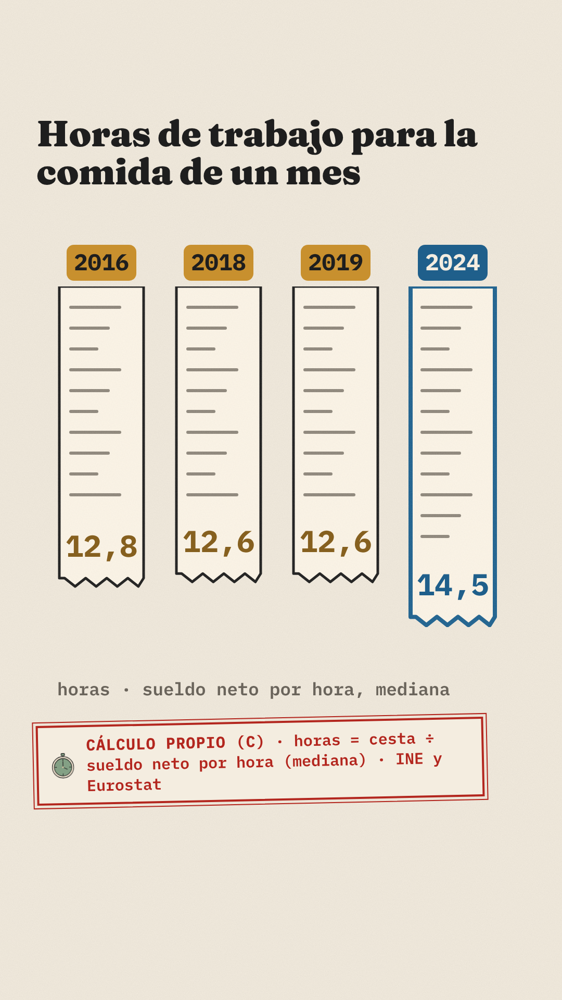
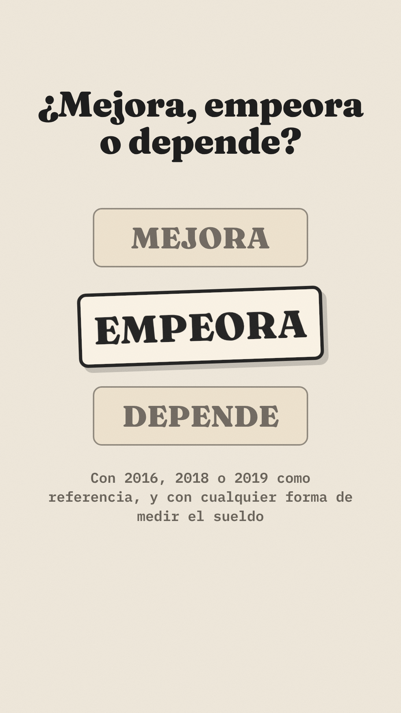

# Biblia del estilo B · La cápsula y el carrito

Ilustración plana sobre papel, con objetos de cartón. Una caja (la cápsula) se abre con objetos de una fecha y se compara con la de hoy. Un carrito de la compra recorre el vídeo con un reloj encima. Objetos, no personajes.

Sistema común (sello, colores del tiempo, cierre, zona segura): `diseno/README.md`.

## Paleta
| Papel | Color | Contraste sobre papel |
|---|---|---|
| Fondo | papel `#F4EDE0` con grano suave | — |
| Texto y contornos | `#1E1E1E` | 14,3:1 |
| Pasado (ficha) | ocre `#C8902E` con texto negro | 5,94:1 |
| Pasado (texto suelto) | ocre oscuro `#86601F` | 4,87:1 |
| Hoy | azul `#1F5F8B` (ficha con texto claro, o texto) | 5,88:1 |
| Objetos | papel oscuro `#E7DCC8`, salvia `#7C9A7E`, cartón `#CDBB98` | Contorno negro de 5 px |
| Notas | gris oscuro `#6A645B` | 5,03:1 |

## Trazo y textura
- Contorno negro de 5 px con esquinas redondeadas en todos los objetos.
- Rellenos planos con textura de cartón (filtro `#carton`: ruido que oscurece un 25 % como máximo).
- Sombras planas desplazadas (12 × 14 px, negro al 25 %) solo en el elemento destacado.
- Titulares en Fraunces 900; cifras en IBM Plex Mono 700 dentro de fichas.

## 10 objetos base
Cápsula (caja de cartón **abierta**, con solapas), carrito, reloj, ticket, nómina, etiqueta de precio, barra de pan, leche, huevos y aceite (`diseno/objetos.mjs`). Todos en tonos neutros; el ocre y el azul solo en fichas y contornos de datos.

## Composiciones tipo

| 1 · El carrito | 2 · Dos cápsulas | 3 · Tickets como barras | Cierre |
|---|---|---|---|
|  |  |  |  |

1. **El carrito:** pregunta arriba, carrito lleno con el reloj encima y la ficha del precio (azul, porque es hoy).
2. **Dos cápsulas:** dos cajas abiertas con la misma compra, la etiqueta del año y debajo la cifra en su ficha.
3. **Tickets como barras** (firma del estilo): cada año es un ticket que se imprime hacia abajo; su largo son las horas. El de hoy lleva contorno azul.
4. **Cierre:** tres etiquetas de cartón; la elegida, adelantada, más grande y con sombra.

## Movimiento (para el Paso 4)
- La cápsula se abre: las solapas giran 0,4 s y los objetos saltan con un rebote suave.
- El carrito entra desde la izquierda y las manecillas del reloj giran hasta las horas del dato.
- Los tickets «se imprimen»: crecen hacia abajo a ritmo constante y la cifra aparece al final.
- Cambio de plano: deslizamiento lateral de papel (0,3 s).

## Prohibido en este estilo
- **Urnas, papeletas, sobres o cajas con ranura.** Una caja con un papel entrando por arriba parece una urna; la cápsula siempre va abierta, con solapas y comida dentro.
- Logos, marcas o nombres de supermercados en tickets, bolsas o productos.
- Personajes o manos: solo objetos.
- Ocre o azul en objetos decorativos (confunden el código pasado/hoy).
- Lo prohibido del sistema común (`diseno/README.md`).

## Riesgos y mitigación
| Riesgo | Mitigación |
|---|---|
| Parecer una infografía genérica | La firma son los tickets que se imprimen y la cápsula abierta, siempre iguales |
| Lectura política de la caja | Caja abierta con solapas y comida; nunca ranura ni papel entrando |
| Demasiados objetos en un plano | Máximo cinco objetos por plano |

## Tests de calidad (autoevaluación)
| Test | Resultado |
|---|---|
| Fotograma | Papel con cartón, tickets o cápsula, fichas de color y sello: se reconoce sin logo |
| Móvil | Cifras de 50-120 px; titulares de 70-96 px |
| Neutralidad | Sin urnas ni partidos; veredicto con contorno y sombra, no con color |
| Dato | Sello en cada plano con cifras |
| Copia | Diseño propio; sin conserje, comunidad de vecinos ni animales |
