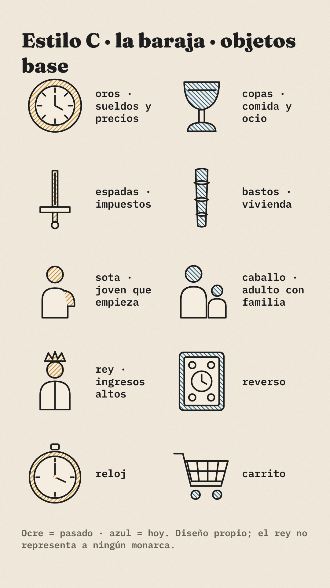
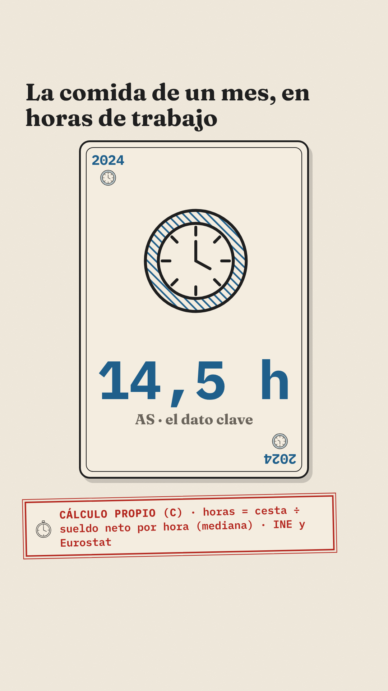
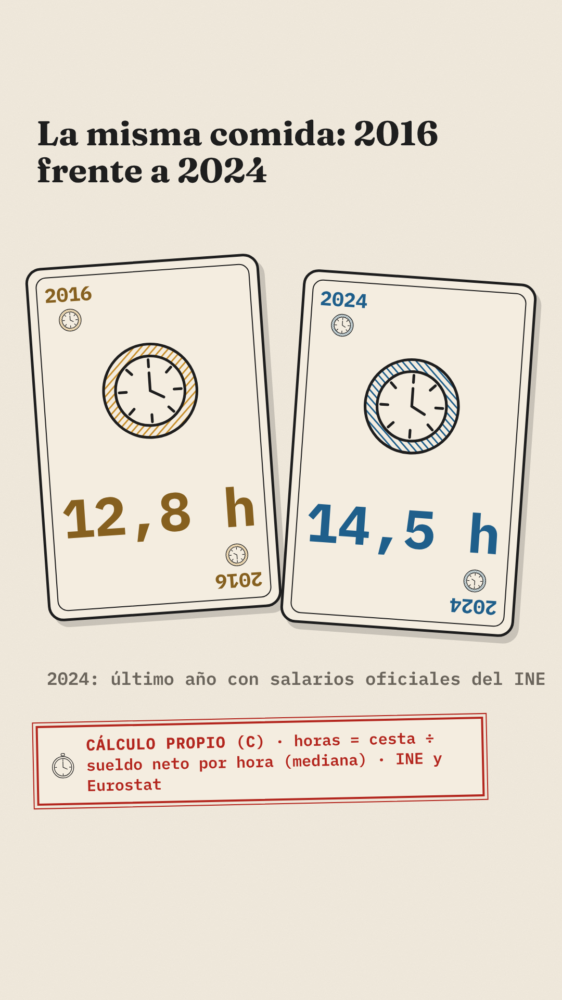
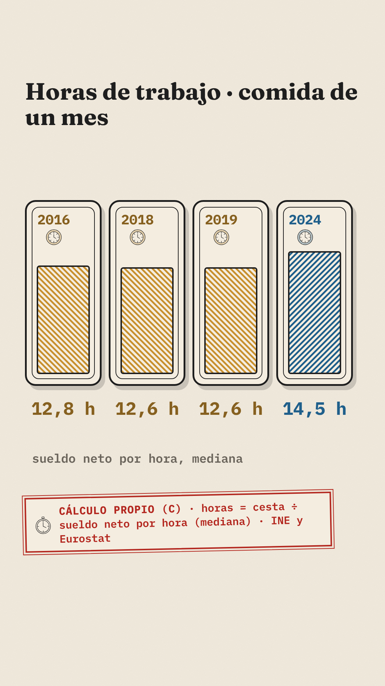
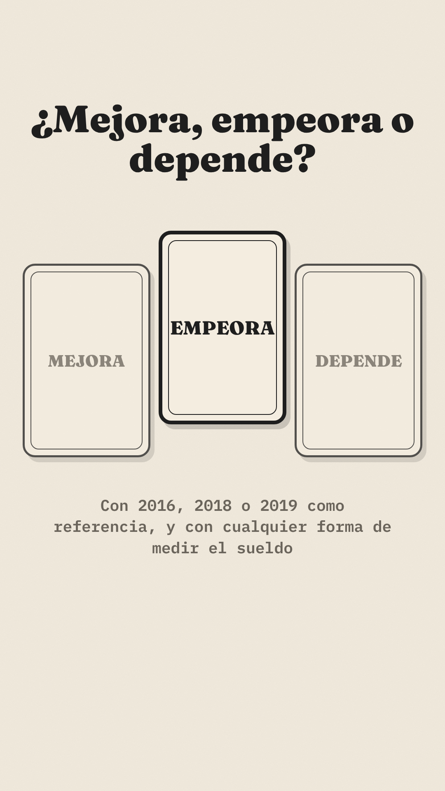

# Biblia del estilo C · La baraja

Cartas de diseño propio, impresas con dos tintas (ocre y azul) sobre papel, como una litografía sencilla. Cada carta es un dato: su índice no es un número de la baraja, sino **el año**. Las cartas solo ordenan datos; no hay juego.

Sistema común (sello, colores del tiempo, cierre, zona segura): `diseno/README.md`.

## Paleta
| Papel | Color | Contraste |
|---|---|---|
| Fondo y cara de la carta | papel `#F4EDE0` | — |
| Contornos y texto | `#1E1E1E` | 14,3:1 |
| Tinta del pasado | trama ocre `#C8902E`; texto en ocre oscuro `#86601F` | 4,87:1 |
| Tinta de hoy | trama azul `#1F5F8B`; texto en azul | 5,88:1 |
| Cartas neutras | trama gris `#8A8378`; texto en gris oscuro `#6A645B` | 5,03:1 |

## Trazo y textura
- Carta: borde negro de 5 px, filete interior de 2 px, esquinas de 30 px y sombra plana.
- Tramas de litografía: líneas diagonales de 5 px cada 9 px; el ocre a 45° y el azul a −45°, para que se distingan también sin color.
- Índices en las esquinas (arriba a la izquierda y, girado, abajo a la derecha): año en IBM Plex Mono 700 y palo.
- Rótulos de carta en Fraunces 700/900.

## Palos y figuras (diseño propio)
| Palo | Capítulo | Dibujo |
|---|---|---|
| Oros | Sueldos y precios | Moneda con esfera de reloj |
| Copas | Comida y ocio | Copa lisa |
| Espadas | Impuestos | Espada recta geométrica |
| Bastos | Vivienda | Bastón con tres nudos |

| Figura | Perfil | Dibujo |
|---|---|---|
| Sota | Joven que empieza | Silueta sin rostro con bolsa |
| Caballo | Adulto con familia | Dos siluetas sin rostro |
| Rey | Ingresos altos | Silueta sin rostro con corona de tres picos; **no representa a ningún monarca** |
| As | El dato clave | Carta con el palo grande y la cifra |

Objetos base (10): oros, copas, espadas, bastos, sota, caballo, rey, reverso (con relojes), reloj y carrito.

## Composiciones tipo

| 1 · El as | 2 · Dos cartas | 3 · La mano | Cierre |
|---|---|---|---|
|  |  |  |  |

1. **El as:** una carta grande con el dato clave de hoy (palo en trama azul, cifra en azul).
2. **Dos cartas:** pasado y hoy, giradas ±4°, cada una en su tinta.
3. **La mano** (firma del estilo): una carta por año; el nivel de trama es proporcional a la cifra, como una barra.
4. **Cierre:** tres cartas; la elegida sube, con borde grueso, y las otras quedan en gris.

## Movimiento (para el Paso 4)
- Las cartas se reparten: entran deslizando desde abajo y giran 0,4 s.
- Se voltean del reverso (relojes) al anverso cuando la voz dice el dato.
- La mano se abre en abanico y luego se alinea.
- En el cierre, la carta elegida sube 80 px.

## Prohibido en este estilo
- **Juego y apuestas:** fichas, tapete verde de casino, dinero sobre la mesa, dados, «apostar», «ganar la partida».
- Copiar barajas comerciales: ni sus figuras, ni sus orlas, ni sus palos dibujados.
- Coronas, escudos o rasgos de monarcas reales; ninguna figura lleva rostro.
- Naipes de póker (corazones, picas, diamantes, tréboles).
- Lo prohibido del sistema común (`diseno/README.md`).

## Riesgos y mitigación
| Riesgo | Mitigación |
|---|---|
| Connotación de juego | Sin apuestas ni dinero en juego; las cartas solo ordenan datos y su índice es el año |
| Que el rey se lea como la monarquía | Figura geométrica sin rostro; corona genérica de tres picos; solo representa un tramo de ingresos |
| Que la trama dificulte leer en el móvil | Cifras siempre fuera de la trama, en texto liso |

## Tests de calidad (autoevaluación)
| Test | Resultado |
|---|---|
| Fotograma | Cartas con índice de año y dos tintas, más el sello: se reconoce sin logo |
| Móvil | Cifras de 50-150 px; índices de 38 px |
| Neutralidad | Rey genérico; sin escudos ni banderas; veredicto con borde y altura, no con color |
| Dato | Sello en cada plano con cifras |
| Copia | Palos y figuras de diseño propio; nada de barajas comerciales |
